<!-- datasheet:banner -->

  <picture>
    <source media="(prefers-color-scheme: dark)" srcset=".github/assets/banner-dark.svg">
    
  </picture>

<!-- /datasheet:banner -->

# Sensor & Display Test Projects

<!-- datasheet:figure -->
## At a glance

  <picture>
    <source media="(prefers-color-scheme: dark)" srcset=".github/assets/diagram-dark.svg">
    
  </picture>

| Characteristic | Detail |
| --- | --- |
| **ESP32 probe** | BME280 on an ESP32 driving a 1.14" 135×240 RGB IPS (ST7789); multi-mode temperature and environment readout |
| **Firmware** | Arduino sketch `esp32_bme280_probe` or MicroPython `esp32_bme280_probe_micropython.py` |
| **Uno probe** | DHT22 and a 0.96" I²C OLED on an Arduino Uno; `i2c_scanner.ino` finds the OLED address (`0x3C` or `0x3D`) |
| **Guide** | Wiring and setup in [`ESP32_BME280_PROBE_GUIDE.md`](ESP32_BME280_PROBE_GUIDE.md) |
<!-- /datasheet:figure -->

## 🌡️ [ESP32 + BME280 + 1.14" (135x240 RGB IPS) Temperature Probe](ESP32_BME280_PROBE_GUIDE.md)
A precision, multi-mode digital temperature probe and environmental monitor running on **ESP32** with a **BME280** sensor and a **1.14" 135x240 RGB IPS screen (ST7789)**.
- **Arduino Firmware**: [`esp32_bme280_probe/esp32_bme280_probe.ino`](esp32_bme280_probe/esp32_bme280_probe.ino) (or [`esp32_bme280_probe.ino`](esp32_bme280_probe.ino))
- **MicroPython Script**: [`esp32_bme280_probe_micropython.py`](esp32_bme280_probe_micropython.py)
- **Wiring & Manual**: [ESP32_BME280_PROBE_GUIDE.md](ESP32_BME280_PROBE_GUIDE.md)

---

# Arduino Uno: DHT22 Sensor + 0.96" I2C OLED Test

## 📁 Primary Code
- **[weather_station.ino](weather_station/weather_station.ino)**: Specially crafted and memory-optimized for the Arduino Uno.
- **[i2c_scanner.ino](i2c_scanner.ino)**: Diagnostic sketch to check I2C communication and find your OLED address (`0x3C` vs `0x3D`).

---

## 🔌 Exact Arduino Uno Wiring Guide

### 1. OLED Display (4-pin I2C SSD1306)
| OLED Pin | Arduino Uno Pin | Notes |
| :--- | :--- | :--- |
| **GND** | **GND** | Ground |
| **VCC** | **5V** | Power (or 3.3V) |
| **SCL** | **A5** | Also available on the dedicated SCL pin next to AREF |
| **SDA** | **A4** | Also available on the dedicated SDA pin next to AREF |

---

### 2. DHT22 Sensor (AM2302)
> ⚠️ **Important on DHT22 modules**:
> - If you have a **3-pin module** (mounted on a small PCB), it already has a built-in resistor. Just connect `+` to 5V, `-` to GND, and `OUT`/`DATA` to Pin 2.
> - If you have a **bare 4-pin DHT22 sensor**, connect a **10kΩ resistor** between **Pin 1 (VCC)** and **Pin 2 (DATA)** as a pull-up.

| DHT22 Pin (from left to right) | Connection | Arduino Uno Pin |
| :--- | :--- | :--- |
| **Pin 1 (VCC)** | Power | **5V** |
| **Pin 2 (DATA)**| Data Signal | **Digital Pin 2** (with 10kΩ pull-up to 5V) |
| **Pin 3 (NC)**  | No Connection | *Leave disconnected* |
| **Pin 4 (GND)** | Ground | **GND** |

---

## 📦 Required Libraries
Open your **Arduino IDE** and go to **Tools** > **Manage Libraries...** (`Ctrl + Shift + I` or `Cmd + Shift + I`):
1. Search for **Adafruit SSD1306** -> Click **Install** (choose "Install All" to get Adafruit GFX as well).
2. Search for **DHT sensor library** (by Adafruit) -> Click **Install** (choose "Install All" to get Adafruit Unified Sensor).

---

## 🚀 Steps to Upload to Arduino Uno
1. Connect your Arduino Uno to your computer via USB.
2. Open **[weather_station.ino](weather_station/weather_station.ino)** in Arduino IDE.
3. In the menu:
   - **Tools > Board** -> Select **Arduino Uno**.
   - **Tools > Port** -> Select your Arduino Uno USB port.
4. Click the **Upload** button (Right arrow icon).
5. Open the **Serial Monitor** (**Tools > Serial Monitor**) and set the baud rate to **9600 baud**.

---

## 💡 Arduino Uno Memory & Stability Notes
- The Arduino Uno (ATmega328P) has **2 KB (2048 bytes) of SRAM**.
- A 128x64 monochrome OLED buffer takes **1024 bytes (50%)** of that memory.
- `arduino_uno_dht22_oled.ino` uses the `F()` macro for all printed strings to store text in Flash program memory instead of consuming precious SRAM, ensuring rock-solid stability without random resets or heap exhaustion.

## License

MIT. See [LICENSE](LICENSE).
